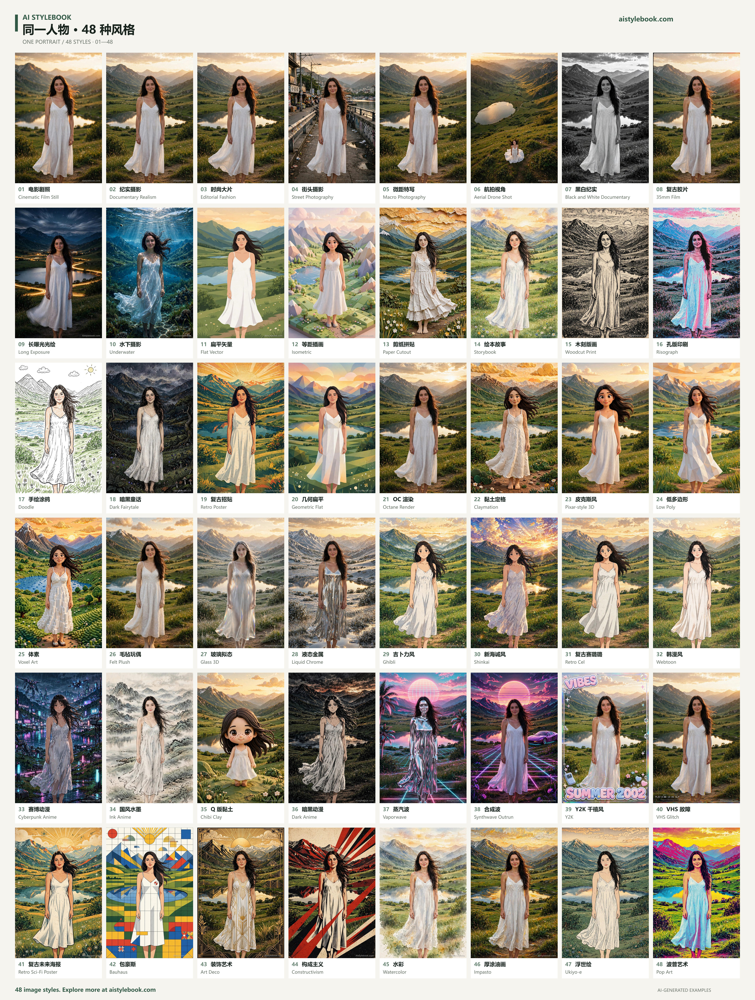
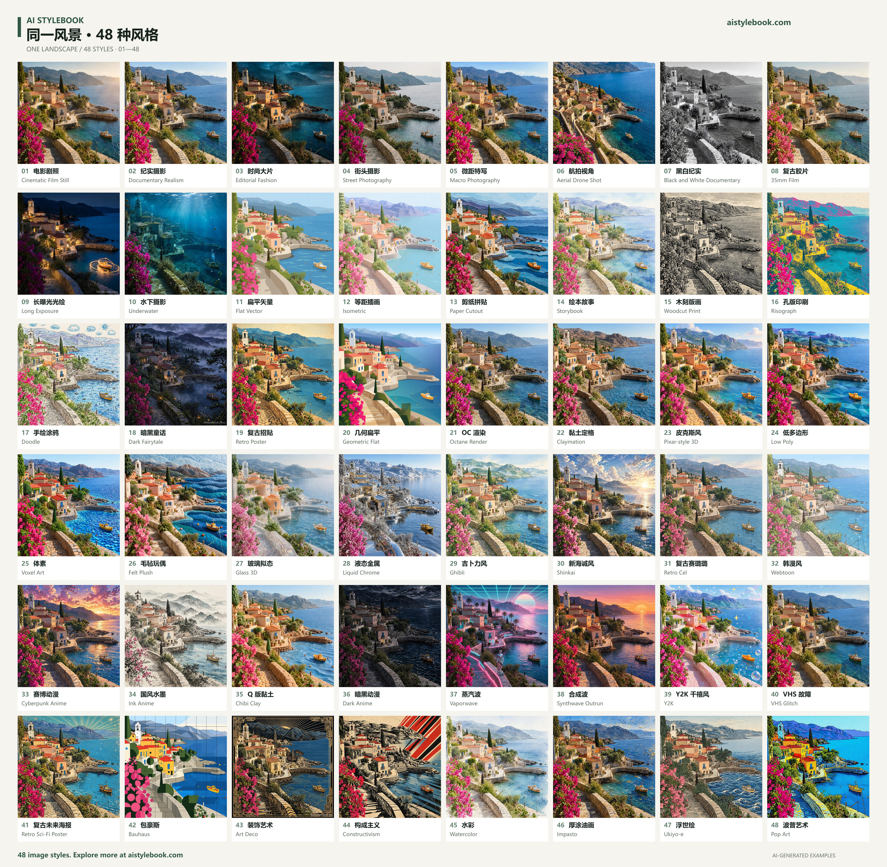
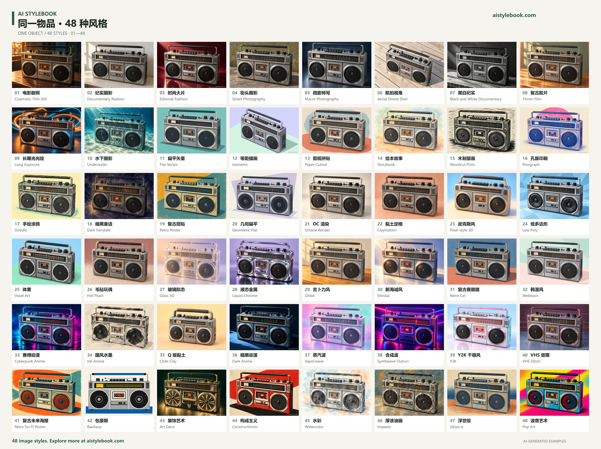

# AI Stylebook · 48 Image Styles Skill

**English** | [简体中文](README.zh-CN.md)

**Name the style you have in mind. Bring it to life with AI.**

[AI Stylebook](https://aistylebook.com/) is a visual handbook of **400+ styles** for creators working with AI or by hand. Through image examples, style guides, and comparisons of the same person, landscape, and object, it helps you find the name of the look you imagine—and turn it into clear directions for color, brushwork, material, and lighting.

**This independent open-source project provides a design skill for only the first 48 image styles. Explore more styles and the full experience at [aistylebook.com](https://aistylebook.com/).**

[Visit the website](https://aistylebook.com/) · [Read the skill](skills/aistylebook-48/SKILL.md) · [Browse all 48 styles](skills/aistylebook-48/references/index.md) · [Choose a style](skills/aistylebook-48/references/choosing.md)

## What this skill does

- Find styles by number, Chinese or English name, material, or visual trait.
- Distinguish similar looks, such as watercolor and storybook, low poly and voxel art, or vaporwave and synthwave.
- Create ready-to-use image prompts that preserve your subject and its defining features.
- Adapt the guidance to people, landscapes, and objects, then check and refine the result against specific visual cues.

Each style has its own guide with signature features, rendering instructions, pitfalls, comparisons, and adjustment advice. Use the skill with an AI assistant that supports `SKILL.md`, or use the included offline Python helper with no third-party dependencies.

## Three subjects, three complete comparison sheets

Each image contains **all 48 styles**, numbered **01–48 from left to right, top to bottom**, in an 8-column × 6-row grid. The numbering is identical across the three sheets, so you can compare how the same style treats a person, a scene, and an object. Click any image to view it at full size.

These AI-generated examples share the same subject setup to illustrate visual treatments. Composition and details may vary between styles; they are not pixel-identical transformations. Use your own content when creating an image—the scenery, text, and props in these examples are not required.

### One person · 48 styles

[](skills/aistylebook-48/assets/people-48.jpg)

### One landscape · 48 styles

[](skills/aistylebook-48/assets/landscape-48.jpg)

### One object · 48 styles

[](skills/aistylebook-48/assets/objects-48.jpg)

## Get started

1. Clone or download this repository:

   ```sh
   git clone https://github.com/jeak01/ai-stylebook.git
   ```

2. Copy the entire `skills/aistylebook-48` folder into your AI tool's supported skills directory, keeping its internal structure. Refer to your tool's documentation for the installation location.
3. Invoke `aistylebook-48` and describe your subject, preferred style, or the feeling you want. You can also ask your assistant to read this repository's `SKILL.md` directly.

For assistants that support `$skill-name` invocation:

```text
Use $aistylebook-48 to turn my uploaded teapot photo into a felt plush artwork.
Preserve the spout, handle, and floral pattern. Use a 4:3 aspect ratio.
```

```text
Use $aistylebook-48 to help me create a warm bookstore illustration with a handmade paper feel.
Compare three suitable styles, then write a complete prompt for the one I choose.
```

```text
Use $aistylebook-48 to explain the difference between low poly and voxel art.
Write a prompt for each using the same red bicycle, subject details, and aspect ratio.
```

If your assistant has an image tool, it can continue to generate an image. Otherwise, the skill provides prompts and review guidance. This repository does not include an image generation service.

## Offline lookup and prompt drafting

Requires Python 3.10 or later. Run these commands from the repository root:

```sh
python skills/aistylebook-48/scripts/stylebook.py list
python skills/aistylebook-48/scripts/stylebook.py search "paper handmade" --limit 3
python skills/aistylebook-48/scripts/stylebook.py show "Watercolor"
python skills/aistylebook-48/scripts/stylebook.py prompt 45 --subject "a red bicycle beside a cafe" --subject-type objects --ratio 4:3
python skills/aistylebook-48/scripts/stylebook.py prompt "Felt Plush" --subject "the teapot in my reference image" --subject-type objects --mode transfer --preserve "handle, spout and floral pattern"
```

- `list`, `search`, and `show` support `--json` for use with other tools.
- `prompt` produces text. It does not call an external API or read or upload your images.
- `show` and `prompt` require an exact ID, name, or alias. Use `search` for less specific descriptions.
- Search matches local names, aliases, and visual tags. For longer requests, extract keywords such as “paper” and “handmade” first.
- The package covers IDs 01–48. Base reference photos are not counted as styles, and out-of-range requests are identified explicitly.

## Included styles

| IDs | Group | Styles |
| --- | --- | --- |
| 01–10 | Photography | Cinematic Film Still, Documentary Realism, Editorial Fashion, Street Photography, Macro Photography, Aerial Drone Shot, Black and White Documentary, 35mm Film, Long Exposure, Underwater |
| 11–20 | Illustration & Graphic Design | Flat Vector, Isometric, Paper Cutout, Storybook, Woodcut Print, Risograph, Doodle, Dark Fairytale, Retro Poster, Geometric Flat |
| 21–28 | 3D & Digital | Octane Render, Claymation, Pixar-style 3D, Low Poly, Voxel Art, Felt Plush, Glass 3D, Liquid Chrome |
| 29–36 | Anime & Comics | Ghibli, Shinkai, Retro Cel, Webtoon, Cyberpunk Anime, Ink Anime, Chibi Clay, Dark Anime |
| 37–44 | Retro & Futurist Design | Vaporwave, Synthwave Outrun, Y2K, VHS Glitch, Retro Sci-Fi Poster, Bauhaus, Art Deco, Constructivism |
| 45–48 | Painting & Print | Watercolor, Impasto, Ukiyo-e, Pop Art |

See the [48-style index](skills/aistylebook-48/references/index.md) for individual guides. Names are lookup labels; the generation instructions describe observable shapes, materials, lines, and lighting.

## Project scope

This repository contains only the skill, guides, three comparison sheets, and local tools for these 48 styles. It does not include the website implementation, the complete style library, runtime configuration, or user data. The package works independently of the website.

```sh
python -m unittest discover -s tests
python tools/audit_release.py
```

**Discover more styles and the full experience at [aistylebook.com](https://aistylebook.com/).**

## License

[MIT](LICENSE).
