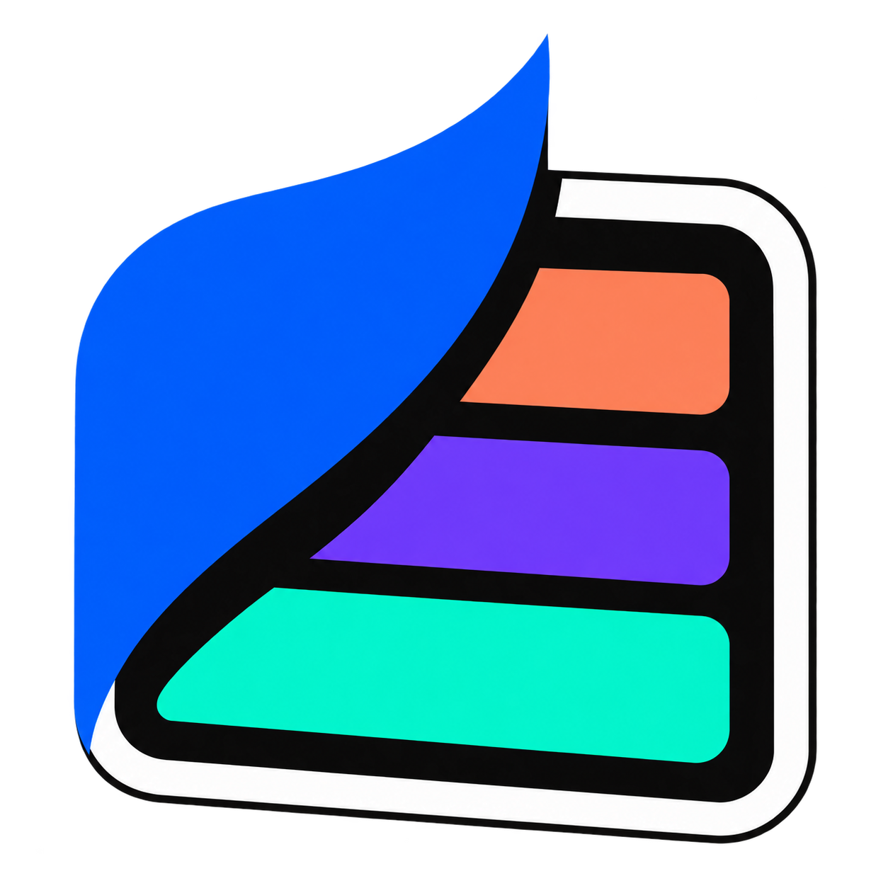

# <a href="https://aistylebook.com/"></a> AI Stylebook · 48 Image Styles Skill

[English](README.md) | **简体中文**

**找到说不出的风格，把它变成自己的作品。**

[AI Stylebook](https://aistylebook.com/) 是一本收录 400+ 种风格、面向所有创作者的视觉风格手册。通过图片示例、风格解读，以及同一人物、风景和物品的视觉对照，帮助你把“想要这种感觉”变成具体的颜色、笔触、材质与光影，让 AI 创作和人工设计都更有方向。

**这个独立开源项目只提供前 48 种图片风格的设计 skill。更多风格与完整体验，请访问 [aistylebook.com](https://aistylebook.com/)。**

[浏览官网](https://aistylebook.com/) · [查看 Skill](skills/aistylebook-48/SKILL.md) · [48 种风格索引](skills/aistylebook-48/references/index.md) · [选择风格](skills/aistylebook-48/references/choosing.md)

## 这个 Skill 能做什么

- 按编号、中英文名称、材质或视觉特征寻找风格。
- 区分相近风格，例如水彩与绘本、低多边形与体素、蒸汽波与合成波。
- 为选定风格生成可直接使用的图片提示词，保留你自己的主体与关键特征。
- 根据人物、风景和物品的差异调整指引，并用明确的风格特征检查和修正结果。

每种风格都有独立指南，包含核心特征、渲染指令、应避免的问题、相近风格区别和调整方法。Skill 可以交给支持 `SKILL.md` 的 AI 助手使用；附带的本地查询脚本不需要第三方 Python 依赖。

## 三个主体，三张完整对照图

每张图片都包含 **48 种风格**，按 **01–48、从左到右、从上到下** 排列，均为 8 列 × 6 行。三张图使用相同的编号，便于观察同一种风格在人像、场景与物品上的不同表达。点击图片可查看完整尺寸。

这些 AI 生成示例来自相同的主体设定，用来比较视觉处理；不同风格的构图和细节可能变化，并非逐像素一致。创作时应使用你自己的内容，示例里的场景、文字与道具不是必需元素。

### 同一人物 · 48 种风格

[](skills/aistylebook-48/assets/people-48.jpg)

### 同一风景 · 48 种风格

[](skills/aistylebook-48/assets/landscape-48.jpg)

### 同一物品 · 48 种风格

[](skills/aistylebook-48/assets/objects-48.jpg)

## 开始使用

1. 克隆或下载这个仓库：
   ```sh
   git clone https://github.com/jeak01/ai-stylebook.git
   ```
2. 将 `skills/aistylebook-48` 整个文件夹放入你的 AI 工具支持的 skills 目录，保留内部结构；具体安装目录以该工具说明为准。
3. 调用 `aistylebook-48`，提供主体、风格或你想表达的视觉感觉。也可以直接让助手读取本仓库的 `SKILL.md`。

在支持 `$skill-name` 调用的助手中，例如：

```text
使用 $aistylebook-48，把我上传的茶壶照片做成毛毡玩偶风格。
保留壶嘴、把手和花纹，画面比例 4:3。
```

```text
使用 $aistylebook-48，我想做一张温暖、有纸张手工感的书店插画。
先比较 3 种适合的风格，再为选中的风格写完整提示词。
```

```text
使用 $aistylebook-48，解释低多边形和体素的区别。
把同一辆红色自行车分别写成两份生成提示词，保持主体和画面比例一致。
```

助手有图片工具时，可以继续生成图片；没有图片工具时，Skill 提供提示词与检查指引。本仓库不附带图片生成服务。

## 本地查询与提示词生成

需要 Python 3.10 或更新版本；在仓库根目录执行：

```sh
python skills/aistylebook-48/scripts/stylebook.py list
python skills/aistylebook-48/scripts/stylebook.py search "纸张 手工" --limit 3
python skills/aistylebook-48/scripts/stylebook.py show "Watercolor"
python skills/aistylebook-48/scripts/stylebook.py prompt 45 --subject "a red bicycle beside a cafe" --subject-type objects --ratio 4:3
python skills/aistylebook-48/scripts/stylebook.py prompt "毛毡" --subject "the teapot in my reference image" --subject-type objects --mode transfer --preserve "handle, spout and floral pattern"
```

- `list / search / show` 支持 `--json`，方便其他工具读取。
- `prompt` 生成文本，不调用外部 API，也不会读取或上传你的图片。
- `show / prompt` 需要准确编号、名称或别名；模糊描述先用 `search`。
- 检索使用本地名称、别名和特征词；长句可先提取“纸张、手工”等关键词。
- 本地内容覆盖 01–48，母版参考图不计入其中；超出范围会明确提示。

## 风格范围

| 编号 | 分组 | 包含 |
| --- | --- | --- |
| 01–10 | 摄影写实 | 电影剧照、纪实摄影、时尚大片、街头摄影、微距特写、航拍视角、黑白纪实、复古胶片、长曝光光绘、水下摄影 |
| 11–20 | 插画平面 | 扁平矢量、等距插画、剪纸拼贴、绘本故事、木刻版画、孔版印刷、手绘涂鸦、暗黑童话、复古招贴、几何扁平 |
| 21–28 | 3D 与数字 | OC 渲染、黏土定格、皮克斯风、低多边形、体素、毛毡玩偶、玻璃拟态、液态金属 |
| 29–36 | 动漫二次元 | 吉卜力风、新海诚风、复古赛璐璐、韩漫风、赛博动漫、国风水墨、Q 版黏土、暗黑动漫 |
| 37–44 | 复古未来 | 蒸汽波、合成波、Y2K 千禧风、VHS 故障、复古未来海报、包豪斯、装饰艺术、构成主义 |
| 45–48 | 艺术绘画 | 水彩、厚涂油画、浮世绘、波普艺术 |

详细指南见 [48 种风格索引](skills/aistylebook-48/references/index.md)。名称用于检索，实际生成指引会进一步描述可见的造型、材料、线条和光照。

## 独立项目边界

本仓库仅包含这 48 种风格的 skill、指引、三张对照图与本地工具，不包含官网实现、完整风格库、运行配置或用户数据。它可以独立使用，不依赖官网服务。

```sh
python -m unittest discover -s tests
python tools/audit_release.py
```

**更多风格与完整体验，请访问 [aistylebook.com](https://aistylebook.com/)。**

## 许可证

[MIT](LICENSE).
